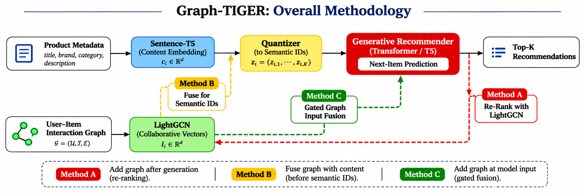

# Graph-TIGER

Semantic-ID generative recommenders such as TIGER and RPG give each item a short code built from its text and predict the next item's code. They never see which items are bought together. Graph-TIGER adds that signal as a gated input to an RPG-style decoder and trains it with an item-level loss.

<div align="center">

</div>

> **Status:** the numbers in this README and in `docs/RESULTS.md` come from earlier runs. They are being re-run on a pipeline whose preprocessing, training windows and tokenizer were checked against RPG's official code, and will be replaced once verified.

## What it does

- **Collaborative input.** Each item has a 128-d vector from a truncated SVD of the item-item transition graph (built from training prefixes only). It enters the decoder through a learned gate: `x = e + sigmoid(W[e; g]) * P g`, with `e` the item's code embedding and `g` the graph vector. The codes stay text-only.
- **Dense item loss.** Next to the per-digit losses, a softmax over 4,096 sampled items on the cosine between the sequence state and the item vector. At scoring time its log-probability is added with a weight chosen on validation.
- **EMA** of the weights (0.99).

Beauty, Sports and Toys (Amazon 2014, 5-core), full-catalog ranking, same splits as RPG, ACERec and TopoGR. Details and significance tests: [docs/RESULTS.md](docs/RESULTS.md). Protocol: [docs/PROTOCOL.md](docs/PROTOCOL.md).

| Test R@10 / N@10 | Beauty | Sports | Toys |
|---|---|---|---|
| TIGER | 0.0648 / 0.0384 | 0.0400 / 0.0225 | 0.0712 / 0.0432 |
| RPG | 0.0809 / 0.0464 | 0.0463 / 0.0263 | 0.0869 / 0.0490 |
| ACERec | 0.0856 / 0.0513 | 0.0494 / 0.0287 | 0.0940 / 0.0591 |
| TopoGR | 0.0883 / 0.0522 | **0.0554 / 0.0314** | **0.0995 / 0.0588** |
| **Graph-TIGER** (3 seeds) | **0.0945 / 0.0533** | 0.0544 / 0.0298 | 0.0983 / 0.0563 |
| Graph-TIGER + EASE blend | 0.0955 / 0.0542 | 0.0576 / 0.0318 | same (weight 0) |

On Beauty it is significantly above RPG on all four metrics and above ACERec and TopoGR on Recall@10. On Sports it matches TopoGR only with the EASE blend; on Toys it is above RPG but not above ACERec or TopoGR on NDCG.

## Setup

```bash
python3 -m venv .venv && source .venv/bin/activate
pip install -r requirements.txt
bash scripts/prepare_data.sh Beauty beauty
```

`prepare_data.sh` downloads the 5-core reviews and metadata into `data/beauty/`, embeds the item text with Sentence-T5-base and builds the transition graph. Use `Sports_and_Outdoors sports` and `Toys_and_Games toys` for the other datasets.

## Train and evaluate

```bash
python main.py --data data/beauty --out results/beauty/ours_s2024 \
    --dense-w 0.3 --ema 0.99 --batch 128 --lr 0.01 --seed 2024
```

Plain RPG-style baseline: add `--no-graph` and drop `--dense-w` and `--ema`. Per-dataset settings chosen on validation (`--digits`, `--lr`, `--batch`):

| | digits | lr | batch |
|---|---:|---:|---:|
| Beauty | 32 | 0.01 | 128 |
| Sports | 16 | 0.003 | 256 |
| Toys | 16 | 0.005 | 128 |

Add `--ease-ws 0,0.5,1,2` for the EASE blend, `--cands 50` for top-50 re-scoring, `--slots 1,2,3` for reserved new-item slots (needs `--holdout` or `--temporal`), `--temporal 0.8,0.9` for the temporal split. Every run writes `result.json` and the per-user ranks.

```bash
python -m scripts.summarize results/beauty plain ours --ref plain
python -m scripts.claims results/beauty beauty ours
```

Baselines: `python -m baselines.ease|sasrec|knn|lightgcn --data data/beauty`. Graph refresh: `python -m scripts.build_graph --prefix-frac 0.7` for a stale graph, then rebuild with `--align-to` and fine-tune with `--init`.

## Layout

```
main.py            train, select on validation, evaluate, write results
src/               data and splits, item codes, graph, model, scoring, trainer, evaluator
baselines/         EASE, SASRec, nearest-neighbour rules, LightGCN
scripts/           data preparation, graph building, significance and summary tables
docs/              results and evaluation protocol
paper/             manuscript
asset/             figures
```

`data/`, `results/`, `logs/` and `ckpt/` stay local and are git-ignored.
